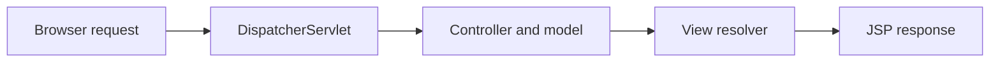

# Spring MVC Tutorial: Controllers, JSP Forms, Validation, and CRUD Examples

Explore **44 Spring MVC example folders** covering request handling, controllers, JSP views, form binding, validation, CRUD, sessions, Post/Redirect/Get, and Spring Security. Use the linked source to answer one web-application question at a time.

[Start here](#start-here) · [Example catalog](docs/EXAMPLES.md) · [Learning path](#learning-path) · [Contribute](CONTRIBUTING.md)

**Version context:** this is historical Spring Framework 5.2.x / Spring Boot 2.3.0 study code, including older controller APIs. It is not a current production template. The source has 44 example folders and 37 POMs immediately inside them; not every folder is a standalone Maven application.

## Find the concept you need

| Question | Examples |
| --- | --- |
| How do I map a request to a controller and view? | [Annotations-ShowHomePage](Annotations-ShowHomePage), [Boot-ShowHomePage](Boot-ShowHomePage) |
| What changes with Java servlet configuration? | [100Percent-CodeDriven-MVC-Application](100Percent-CodeDriven-MVC-Application), [Abstract initializer](100Percent-AbstractAnnoConfigDispServlet) |
| How do I bind and validate a form? | [InitBinder](Annotations-InitBinder), [Annotated validation](Form%20Validation-Annotations-SFC), [Programmatic validation](Form%20Validation-Programatic-SFC) |
| Where is a Spring MVC CRUD example? | [Annotations-MiniProject-CURD](Annotations-MiniProject-CURD), [Boot-CURD-Operations](Boot-CURD-Operations) |
| How can I study duplicate form submission and PRG? | [RedirectToGetMode](SFC-DoublePostingProblem-RedirectToGetMode), [FlashAttribute](SFC-DoublePostingProblem-SessionScope-FlashAttribute) |
| Where are file-upload and download examples? | [Annotations-FileUploading-FileDownloading](Annotations-FileUploading-FileDownloading) |
| How do JDBC-backed login and encryption appear in the source? | [Database authentication](Security-MVC-Database-Authentication), [Encryption example](Security-MVC-Encryption) |
| How are i18n and batch processing configured? | [Internationalization](Internationalization-MVC-webapp), [Batch readers/writers](Batch-POC-CustomRWs) |

See the [complete catalog](docs/EXAMPLES.md) for project formats and source links.

## Start here

Read **Boot-ShowHomePage** as the smallest annotated controller example. Its source maps `/welcome.htm` to the `home` view and configures JSPs under `/WEB-INF/pages/`.

```sh
git clone https://github.com/dibyapp/spring-mvc-all-concepts-tutorial.git
cd spring-mvc-all-concepts-tutorial/Boot-ShowHomePage
```

Use a compatible Java 8 toolchain. Build the WAR with `sh ./mvnw package` on macOS/Linux or `.\mvnw.cmd package` on Windows PowerShell. The wrapper downloads Maven on first use.

For JSP rendering, deploy `target/Boot-ShowHomePage-0.0.1-SNAPSHOT.war` to a local **Tomcat 9** installation. Open the deployed context followed by `/welcome.htm`, normally `http://localhost:8080/Boot-ShowHomePage-0.0.1-SNAPSHOT/welcome.htm` when deployed under that WAR name. Use the actual context configured in your server.

The bundled properties set port **4040** for an embedded Spring Boot launch; that does not change an external Tomcat server's port. An embedded `spring-boot:run` startup alone does not prove JSP rendering works: this POM does not explicitly include Jasper. The external-container path avoids promising an unverified embedded JSP setup.

Read [ShowHomeController.java](Boot-ShowHomePage/src/main/java/com/dib/controller/ShowHomeController.java), [application.properties](Boot-ShowHomePage/src/main/resources/application.properties), and [home.jsp](Boot-ShowHomePage/src/main/webapp/WEB-INF/pages/home.jsp) together.

## Learning path

1. Trace request mapping → controller → logical view → JSP.
2. Compare XML, annotation, and Java-based configuration.
3. Study binding and validation before database-backed forms.
4. Compare the three duplicate-submission examples and their state handling.
5. Explore CRUD and sessions with a disposable local database.
6. Treat security, uploads, Tiles, and batch modules as separate legacy case studies.



## Compatibility and troubleshooting

- `javax.servlet` applications target the older Java EE namespace. Tomcat 10+ uses Jakarta APIs and requires a deliberate migration; changing only the README is insufficient.
- Legacy `SimpleFormController` / abstract controller examples may require an older framework or source repair. Do not assume all code matches one dependency version.
- Oracle JDBC, LDAP, and schema-dependent modules require their own setup. Use synthetic data and your own local configuration.
- The collection includes nested workspace/build output. Use a short checkout path on Windows if Git reports path-length errors.
- No blanket build, security, or performance certification is claimed.

Compare the source with the [official Spring MVC documentation](https://docs.spring.io/spring-framework/reference/web/webmvc.html). For new production applications, select supported dependencies and test the migration separately.

## What has been checked?

The Boot-ShowHomePage existing tests check passed locally. [Validation scope](docs/VALIDATION.md) · [CI](https://github.com/dibyapp/spring-mvc-all-concepts-tutorial/actions/workflows/starter-check.yml). This is a limited check, not certification of the whole repository.

## Continue learning

| What you want to understand | Repository |
| --- | --- |
| IoC, dependency injection, bean lifecycle, AOP | [Spring Core examples](https://github.com/dibyapp/spring-core-all-concepts-tutorial) |
| Controllers, JSP forms, validation, CRUD, PRG | [Spring MVC examples](https://github.com/dibyapp/spring-mvc-all-concepts-tutorial) |
| Requests, sessions, cookies, dispatching, JDBC | [Java Servlet examples](https://github.com/dibyapp/java-servlets-all-concepts) |
| Spring Boot 3.1 JPA/MySQL native-image demo | [Spring Boot GraalVM demo](https://github.com/dibyapp/spring-boot-graal-demo) |
| Explicit native Maven profile experiment | [GraalVM application](https://github.com/dibyapp/graalvm-app) |
| Historical Boot 3.0 AOT/Kubernetes experiment | [Spring native study project](https://github.com/dibyapp/spring-native) |

## Contribute or report a problem

Found a broken example? Include its folder, Java/tool versions, a minimal reproduction, and a sanitized error. See [CONTRIBUTING.md](CONTRIBUTING.md). A small fix with a repeatable before/after result is useful; unverified performance claims are not.

Maintained by [dibyapp](https://github.com/dibyapp). [MIT](LICENSE) applies to the author's original contributions; inherited material and bundled third-party files retain their own terms. Read [THIRD_PARTY_NOTICES.md](THIRD_PARTY_NOTICES.md). If an example helped you understand a concept, a star or a link to that specific example helps other learners find it.
